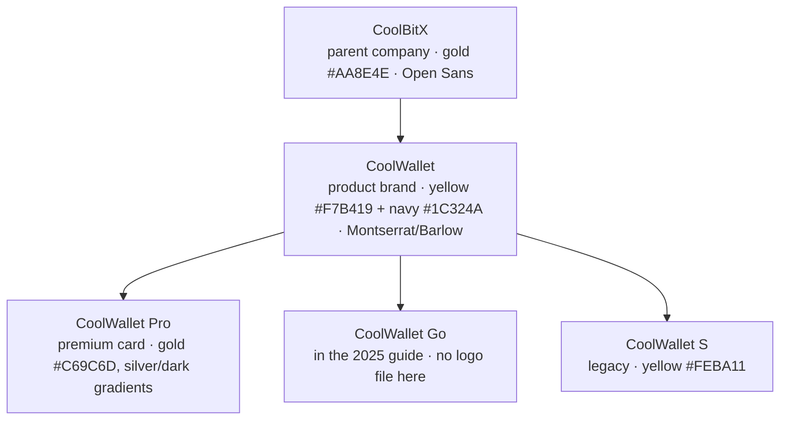

# CoolBitX UI Guide: agent instructions

This folder is a brand kit for AI agents (and people) who build UI for **CoolBitX** and its **CoolWallet** products. Use the assets as they are, follow the rules below, and do not invent brand elements this folder does not have.

Fastest way in: open `examples/index.html`. It is a working page that uses every token, both font families and the main logos. Add `?brand=coolwallet-pro&theme=light` (or `coolbitx`, `dark`) to the URL to preview another theme.

**Source of truth:** the CoolBitX brand-assets Google Drive folder, <https://drive.google.com/drive/folders/1s5_IJSWL6yyM9jm3GTN6jFuWez9vx468>. This folder is a processed copy of it.
**Last synced:** 2026-11-08 (Drive export of 2026-11-02). When the Drive changes, follow section 10.

## 1. Brand architecture: pick the brand first



| You are building… | `data-brand` | Logo folder |
|---|---|---|
| Wallet app screens, CoolWallet marketing site, generic product pages | `coolwallet` | `logos/coolwallet/` |
| A page or screen about the Pro card | `coolwallet-pro` | `logos/coolwallet-pro/` |
| Company site, investor/careers/press pages, B2B or corporate material | `coolbitx` | `logos/coolbitx/` |
| Anything about CoolWallet S | `coolwallet` + S logo | `logos/coolwallet-s-legacy/` (discontinued; use only when S is the subject) |

On product UI, CoolBitX appears only as an endorsement ("Powered by CoolBitX"), small, near the footer.

## 2. Quick start

```html
<link rel="stylesheet" href="fonts/fonts.css">
<link rel="stylesheet" href="tokens/tokens.css">
<!-- CoolBitX only: Open Sans is not bundled -->
<link rel="stylesheet" href="https://fonts.googleapis.com/css2?family=Open+Sans:wght@400;600;700&display=swap">

<html data-brand="coolwallet" data-theme="light">  <!-- or dark -->
```

Build on the **semantic** tokens (`--color-bg`, `--color-surface`, `--color-text`, `--color-text-muted`, `--color-border`, `--color-accent`, `--color-on-accent`, `--color-link`, `--color-strong-bg`, `--color-on-strong`, `--font-display`, `--font-body`). Use the primitives (`--cw-*`, `--cwp-*`, `--cbx-*`) only when you need one specific brand color. `tokens/tokens.json` has the same primitives in W3C design-token format, for Tailwind, Figma or native platforms.

## 3. Folder map

| Path | Contents |
|---|---|
| `tokens/tokens.css` | CSS variables: brand primitives + semantic themes per brand × light/dark |
| `tokens/tokens.json` | Same primitives as design tokens, each with its source |
| `fonts/` | Montserrat + Barlow TTF (weights 300–700, upright) and `fonts.css` |
| `logos/<brand>/` | SVG (preferred) + PNG for every lockup. Naming: `<brand>-<layout>-<color>.<ext>` |
| `images/` | Product photography, max 2000 px. See `images/INDEX.md` (tone, size, transparency) and `images/<product>/contact-sheet.jpg` |
| `reference/brand-guides/` | The three official guides as PDF + PNG render. These are the source of truth: read the PNG when unsure |
| `reference/ad-banners/` | Official Google display ads (CoolWallet, CoolWallet Pro): the brand as it is actually applied |
| `reference/product-specs.md` | Card hardware/function specs (2018) and official taglines |
| `reference/source-manifest.tsv` | sha256 of every Drive file at the last sync, used by the sync script to detect changes |
| `examples/index.html` | Working sample page |
| `scripts/sync-from-drive.sh` | Rebuilds the asset folders from a fresh Drive download (section 10) |
| `.claude-plugin/`, `skills/ui-guide/SKILL.md` | Packages this repo as the Claude Code plugin `coolbitx` (section 11). `SKILL.md` is a short summary of this file: keep the two consistent |

**Generated vs hand-written.** `logos/`, `fonts/montserrat/`, `fonts/barlow/`, `images/` (including `INDEX.md` and the contact sheets), `reference/brand-guides/`, `reference/ad-banners/` and `reference/source-manifest.tsv` are **regenerated by the sync script**. Never edit them by hand, because the next sync overwrites them. Everything else is hand-written, and the script never touches it.

## 4. Color

**Note:** the official guides print wrong RGB values next to their hex codes (for example "RBG-252 23 185" for `#F7B419`). The **hex** is correct. The RGB values below are recalculated from the hex.

| Token | Hex | RGB | Source | Role |
|---|---|---|---|---|
| `--cw-yellow` | `#F7B419` | 247 180 25 | CW 2025 | Primary accent: CTA fills, highlights, dark-mode wordmark |
| `--cw-navy` | `#1C324A` | 28 50 74 | CW 2025 | Brand dark: hero bands, dark-mode surface |
| `--cw-charcoal` | `#1B202A` | 27 32 42 | CW 2025 / CBX | Text on light, dark background |
| `--cw-gray` | `#939393` | 147 147 147 | CW 2025 / CBX | Secondary text **on dark only**, dividers |
| `--cw-ink` | `#1A1A1A` | 26 26 26 | logo files | Fill of the dark logos |
| `--cw-paper` | `#E6E6E6` | 230 230 230 | guide background | Light surface |
| `--cwp-gold` | `#C69C6D` | 198 156 109 | CW 2020 (Pro) | Pro accent |
| `--cwp-gradient-gold/silver/dark` | see CSS | n/a | CW 2020 (Pro), sampled | Pro hero/card treatments |
| `--cws-yellow` | `#FEBA11` | 254 186 17 | S logo file | Legacy S only |
| `--cbx-gold` | `#AA8E4E` | 170 142 78 | CBX 2020 | CoolBitX accent (the logo SVG uses `#AF9241`; keep the file as is) |

### Contrast rules (WCAG, measured)

| Pair | Ratio | Rule |
|---|---|---|
| Yellow on white | 1.8 | ❌ Never use yellow text or thin yellow lines on light backgrounds. Yellow is a **fill** on light |
| Charcoal on yellow | 8.9 | ✅ Text on yellow buttons is charcoal, not white (white on yellow is 1.8) |
| Yellow on navy / charcoal / black | 7.2 / 8.9 / 11.5 | ✅ Yellow text works on dark |
| Gray `#939393` on white / paper | 3.1 / 2.5 | ❌ Not for body text on light. Use `--color-text-muted` (`#5C5C5C`) |
| Gray on charcoal / navy | 5.3 / 4.3 | ✅ on charcoal; on navy only for large text (≥ 24 px, or ≥ 19 px bold) |
| Pro gold on black / charcoal | 8.4 / 6.5 | ✅ text OK on dark; on white 2.5, so fills only |
| CoolBitX gold on white | 3.1 | Large display text, rules and fills only. Links use `#7A6234` |

## 5. Typography

| Brand | Display / headings | Body / UI / numbers |
|---|---|---|
| CoolWallet (all products) | **Montserrat** (400–600; the guide uses Regular/Medium) | **Barlow** (400–500; 600 for emphasis) |
| CoolBitX | **Open Sans** | Open Sans; Helvetica Neue as secondary |

The guides name the families but do not assign roles. The display/body split above is derived from how the guides and banners use them: Montserrat for headings, Barlow for body copy. Recommended scale (derived): 14 / 16 / 20 / 24 / 32 / 40 / 56 px. Body text is 16 px Barlow at line-height 1.5. Headings use line-height 1.15 and Montserrat weight 500, with no all-caps. For tabular numbers (balances, prices), use Barlow with `font-variant-numeric: tabular-nums`.

**CJK:** neither family has Chinese or Japanese glyphs. Add `"Noto Sans TC"` (Traditional Chinese) or `"Noto Sans JP"` after the Latin family in the stack.

## 6. Logos

**Rules from the official guides:**

1. Exclusion zone: keep clear space of **½ the shield (icon) height** on every side of the logo.
1. The full-color logo goes **only on a black or white background**. On any other color or a photo, use a monochrome logo (black or white).
1. Use the black (dark) logo on light backgrounds and the white logo on dark backgrounds.
1. Dark mode (2025 guide): on navy, the CoolWallet wordmark may appear in **yellow** (`#F7B419`).

**Rules for agents:**

- Use the files. **Never** retype the wordmark in Montserrat or any other font: the "oo" in CoolWallet/CoolBitX is a custom ligature, and retyped text looks wrong.
- Never recolor, stretch, rotate, outline, add shadows to, or crop a logo. The only allowed recoloring is solid black, white, or (CoolWallet, dark mode) yellow.
- Prefer SVG. Use PNG only where SVG is impossible (email, some native contexts).
- Minimum size (derived): horizontal lockup at least 96 px wide; shield alone at least 20 px tall.
- **Missing assets: do not fake them.** There is no CoolWallet Go logo file, and no standalone CoolBitX logomark (the ∞ mark). If you need one, put in a labeled placeholder and tell the user to get the file from the brand team (the CoolBitX guide lists yiting.huang@coolbitx.com as its contact; that may be out of date).

| Need | File |
|---|---|
| CoolWallet header on light | `logos/coolwallet/coolwallet-horizontal-dark.svg` |
| CoolWallet header on dark/navy/photo | `logos/coolwallet/coolwallet-horizontal-white.svg` |
| App icon / favicon / avatar | `logos/coolwallet/coolwallet-shield-dark.svg` or `-white.svg` (centered in a circle of charcoal `#1B202A` or yellow `#F7B419`, as in the 2025 guide) |
| Stacked (square spaces, splash) | `logos/coolwallet/coolwallet-vertical-{dark,white}.svg` |
| Text-only | `logos/coolwallet/coolwallet-wordmark-{dark,white}.svg` |
| Dark mode on navy `#1C324A` (2025 guide) | `logos/coolwallet/coolwallet-wordmark-yellow.svg` (wordmark only; no yellow shield lockup exists) |
| Pro, premium dark | `logos/coolwallet-pro/coolwallet-pro-horizontal-gold.svg` or `-silver.svg` |
| CoolBitX | `logos/coolbitx/coolbitx-logo-{gold,black,white}.svg` (gold only on white or black) |

The `*-white.svg` files in `coolwallet/` (horizontal, vertical, wordmark), `coolwallet-wordmark-yellow.svg`, and the black/white CoolBitX SVGs were made by swapping the fill of the official SVG. The shapes are unchanged.

## 7. UI patterns seen in official material

From `reference/ad-banners/` and the product photography:

- **Dark-first.** Product marketing uses black or charcoal backgrounds with deep-blue "moon" card imagery. Light layouts use white or `#E6E6E6` with plenty of space.
- **CTA** = solid yellow rectangle, small radius (~2 px), short sentence-case label ("Learn more"), charcoal text. (The yellow in the banners renders as about `#D9AB31`; use the token `#F7B419`.)
- **Logo top-left or top-center, in white**. On wide formats, a thin vertical divider separates logo and tagline.
- Headlines are short, sentence case, light-to-regular weight. No exclamation marks, no all-caps.
- The hardware is a credit-card-sized card with rounded corners. Card-shaped panels (`--radius-card`) echo it.
- Pro imagery: blue moon-texture card, metallic silver/gold logo. S imagery: black card, gold shield, constellation pattern.

## 8. Voice (for UI copy)

Calm, secure, precise. CoolWallet's own description of the shield: "stability, protection, and confidence". Prefer plain words ("Your keys never leave the card") over hype ("revolutionary!!"). Do not make security or certification claims beyond `reference/product-specs.md`, and check those first because they date from 2018.

## 9. What was removed from the original download, and why

The source was a Google Drive export of about 529 MB. This guide keeps only what an agent can use to build UI. These were removed (the originals are still on the [source Drive folder](https://drive.google.com/drive/folders/1s5_IJSWL6yyM9jm3GTN6jFuWez9vx468)), and the sync script skips the same categories:

- 8 marketing videos (MP4/MOV, ~340 MB): not usable as UI assets
- Printed user manuals EN/ZH/JP (~98 MB), Getting Started and Recovery Card print inserts, spec-sheet PDFs (transcribed into `reference/product-specs.md`)
- Custom-card print guidelines (Illustrator files + demo clip): for physical card printing, not UI
- All Adobe Illustrator `.ai` masters (one was a byte-identical duplicate): SVG/PNG exports are kept
- A 29 MB event photo (CoolBitX at Startup Island Taiwan)
- Font zips: replaced by the upright 300–700 weights of each family
- Product photos were recompressed: long edge capped at 2000 px, opaque PNGs saved as JPEG (q85)

For editable `.ai` masters or print files, go to the Drive. This folder does not have them.

## 10. SOP: syncing when the Drive folder is updated

Run this when the brand team says the Drive changed, or to check every few months. The script takes a few minutes, needs ImageMagick 7 (`magick`), poppler (`pdftoppm`) and `unzip`, and runs on macOS and Linux.

1. **Download.** Open the [source Drive folder](https://drive.google.com/drive/folders/1s5_IJSWL6yyM9jm3GTN6jFuWez9vx468), select everything inside it (both `CoolBitX brand assets` and `CoolWallet brand assets`), then right-click → **Download**. Drive splits large exports into several zips (`drive-download-…-001.zip`, `-002.zip`, …): unzip **all** of them into **one new, empty folder outside this guide**, for example `~/Downloads/cbx-drive-new/`. Unzipping several parts into the same folder merges them.
1. **Check what changed** without modifying anything:

   ```bash
   scripts/sync-from-drive.sh --check ~/Downloads/cbx-drive-new
   ```

   The report has three parts:
   - `ADDED` / `CHANGED` / `REMOVED`: every Drive file that differs from `reference/source-manifest.tsv`.
   - `UNMAPPED`: new files the script does not know where to put (for example a new logo folder). New photos in an existing photo folder and new banners are picked up automatically and are not listed here.
   - `MISSING`: files the script expects but the Drive no longer has (usually a rename on Drive).
1. **Decide on UNMAPPED and MISSING files** (skip this step if there are none):
   - New asset worth keeping (a logo, a new product folder): add a `cpy`/`img_dir` line in the matching section of `scripts/sync-from-drive.sh`, using the naming pattern `<brand>-<layout>-<color>.<ext>`.
   - Not useful for UI (videos, print files, `.ai`): add a pattern to `is_ignored()` in the script.
   - Renamed on Drive: update the source path in the script.
   - Run `--check` again until the report contains only intended items.
1. **Sync:**

   ```bash
   scripts/sync-from-drive.sh ~/Downloads/cbx-drive-new
   ```

   This rebuilds the generated folders, moves the old versions to the Trash (or deletes them where there is no `trash` command), and rewrites `reference/source-manifest.tsv`.
1. **Do the follow-ups the report lists:**
   - **Brand guide changed:** read the new `reference/brand-guides/*.png`. If colors, fonts, or logo rules changed, update `tokens/tokens.css`, `tokens/tokens.json` and sections 4–6 of this file. Re-check the contrast table for every new color.
   - **Spec sheet changed:** re-transcribe `reference/product-specs.md` from the PDF in the download.
   - **New logo or product** (for example the CoolWallet Go logo): add it to the brand-architecture diagram (section 1), the logo table (section 6), and remove it from the "missing assets" note.
1. **Verify:** open `examples/index.html` in all three brands × both themes, and check that no image is broken and the logos look right. If a file that this guide or `examples/` references was renamed, search for the old name and fix every reference.
1. **Record:** update **Last synced** at the top of this file. If a rule changed, update `skills/ui-guide/SKILL.md` to match.
1. **Publish:** commit with a message that lists the changed Drive files, then push. Plugin users get the update on their next marketplace refresh (section 11).
1. **Clean up:** delete the downloaded zips and the unzipped folder.

## 11. Claude Code plugin

This repo is also a Claude Code plugin marketplace (`coolbitx-ui-guide`) with one plugin (`coolbitx`) that contains one skill (`ui-guide`). Once a teammate installs it, Claude loads the guide automatically whenever they build CoolBitX or CoolWallet UI, in any project, without cloning this repo.

- **Install** (needs read access to this private repo through the teammate's own git credentials):

  ```
  /plugin marketplace add CoolBitX-Technology/coolbitx-ui-guide
  /plugin install coolbitx@coolbitx-ui-guide
  ```

  Claude Code 2.1.275 or later can do both in one step: `/plugin install coolbitx --marketplace CoolBitX-Technology/coolbitx-ui-guide`.
- **Install from a clone** when the commands above fail with "Repository not found". Claude Code clones the marketplace with your machine's default GitHub credentials, so this happens when they belong to an account outside the org (for example, a personal account as the default, with org access only through a per-repo credential helper). Point the marketplace at a local clone instead; git, with whatever credentials work for you, handles the fetching:

  ```
  /plugin marketplace add ~/path/to/coolbitx-ui-guide
  /plugin install coolbitx@coolbitx-ui-guide
  ```

  To update, `git pull` in the clone, then follow **Updates** below.
- **Use:** the skill fires on its own when someone asks for CoolBitX or CoolWallet UI. To invoke it directly, use `/coolbitx:ui-guide`.
- **Updates:** `plugin.json` has no `version`, so every pushed commit is a new release. If a teammate doesn't see a change, they run both `/plugin marketplace update coolbitx-ui-guide` and `/plugin update coolbitx@coolbitx-ui-guide`, then restart Claude Code. The first command alone only refreshes the catalog and leaves the installed plugin on its old commit. Background auto-update of a private repo may need a GitHub token in the environment.
- **Cost:** about 250 tokens in every session (the skill description), and about 1.1k tokens when the skill fires. The install copies the whole repo (about 22 MB) into the plugin cache.
- **Check after editing** `.claude-plugin/` or `SKILL.md`: run `claude plugin validate .` (it should end in "Validation passed with warnings"; four warnings are expected and need no fix: no `version` (deliberate, see Updates), root `CLAUDE.md` not loaded (it's this repo's agent pointer, not plugin content), no license (only the public plugin directory requires one, and this plugin isn't submitted there), no icon (there is no square CoolBitX mark)), and `claude --plugin-dir . plugin details coolbitx`.
