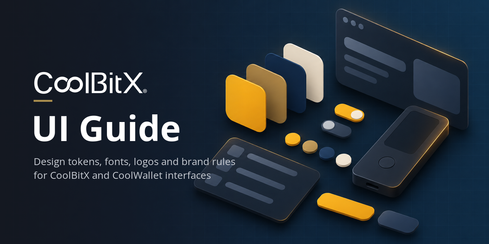

# CoolBitX UI Guide

Brand kit for building CoolBitX and CoolWallet interfaces: design tokens, fonts, logos, product photography, and the official brand guides.

- **For Claude Code:** install the plugin, and Claude will use the guide whenever you build CoolBitX or CoolWallet UI, in any project:

  ```
  /plugin install coolbitx --marketplace CoolBitX-Technology/coolbitx-ui-guide
  ```

  On Claude Code older than 2.1.275, run `/plugin marketplace add CoolBitX-Technology/coolbitx-ui-guide` and then `/plugin install coolbitx@coolbitx-ui-guide`. If either fails with "Repository not found", your default GitHub credentials can't see this private repo: clone it with credentials that can, and run `/plugin marketplace add <path-to-clone>` instead. Details are in [`AGENTS.md` §11](AGENTS.md#11-claude-code-plugin).
- **For other AI agents:** point the agent at this folder. It reads [`AGENTS.md`](AGENTS.md), which has the brand rules, which logo to use, the color contrast rules and the folder map.
- **For people:** open [`examples/index.html`](examples/index.html) in a browser to see everything in use, or read the official guides in `reference/brand-guides/`.
- **License:** the logos, photos and brand guides are CoolBitX trademarks and copyrighted works, shared for representing CoolBitX products correctly. The fonts are OFL 1.1, and the docs, tokens and code are MIT. See [`LICENSE`](LICENSE).
- **Source:** [CoolBitX brand-assets Google Drive folder](https://drive.google.com/drive/folders/1s5_IJSWL6yyM9jm3GTN6jFuWez9vx468). When it changes, follow the sync SOP in [`AGENTS.md` §10](AGENTS.md#10-sop-syncing-when-the-drive-folder-is-updated) (`scripts/sync-from-drive.sh`).

```
AGENTS.md          rules for agents (canonical)
tokens/            tokens.css (CSS variables, themes) · tokens.json (design tokens)
fonts/             Montserrat + Barlow · fonts.css
logos/             coolbitx · coolwallet · coolwallet-pro · coolwallet-s-legacy (SVG + PNG)
images/            product photos · INDEX.md · contact sheets
reference/         official brand guides · ad banners · product specs · source manifest
examples/          index.html sample page
scripts/           sync-from-drive.sh (rebuild from a fresh Drive download)
.claude-plugin/    Claude Code plugin + marketplace manifests
skills/ui-guide/   SKILL.md: the Claude Code skill (summary of AGENTS.md)
```
